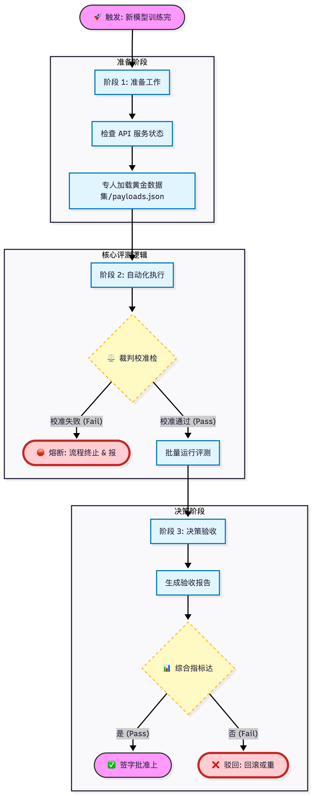

# AI Evaluation Metrics · 大模型合规与风险评测

A low-cost, locally runnable framework for evaluating large language models on **compliance, financial-crime and hallucination risks**, plus a **RAG prototype for drafting tender (bid) documents**. Built during an AI engineering internship (Dec 2025 – Feb 2026) on a single laptop, using public data only.

在实习期间（2025.12 – 2026.02）搭建的大模型评测体系：在单机、本地部署、仅使用公开数据的条件下，评测模型在合规安全、金融犯罪拒答与幻觉风险上的表现；另含一个招投标 RAG 原型。

## Highlights

- **Golden dataset** – 394 samples tagged with 27 risk types, filtered from seven public benchmarks (SafetyBench, BeaverTails, CMMLU, GSM8K, HaluEval, HaluEval-Wild, TruthfulQA) with keyword, complexity and stratified sampling rules. See `大模型评测体系构建与优化/merger_all.json`.
- **Evaluation arena** – a Streamlit app that runs a local Qwen3 model (any OpenAI-compatible endpoint, e.g. Xinference) and a cloud model side by side, scoring answers in parallel with regex rules for multiple choice, refusal-keyword checks for safety prompts, and DeepSeek as an LLM judge for hallucination and truthfulness.
- **Reporting** – radar charts per risk dimension, a bad-case list, and a CSV report linking each prompt, output, score and reason (sample: `arena_report.csv`, 50 prompts). `<think>` traces are stripped so reasoning models can be scored.
- **RAG bid drafting** – Selenium crawler for public procurement notices, PDF/Word text cleaning, a ChromaDB + SentenceTransformer knowledge base, and Qwen3 generation of bid sections.

## Evaluation workflow · 评测验收流程

Prepare (check the API, load the golden set) → calibrate the judge and stop on failure → run the batch → generate the acceptance report → approve or roll back.



## Repository layout

```
大模型评测体系构建与优化/                  LLM evaluation framework
  <benchmark folder>/convert_*.py           per-benchmark filtering and conversion
  merge_datasets.py                         merges the converted subsets into merger_all.json
  merger_all.json                           394-sample golden dataset
  eval_dashboard_universal_final.py         Streamlit evaluation arena
Bidbeach_generation/                       RAG bid-drafting prototype
  Bidbeach_evaluation/                      crawler, text cleaning, extraction eval, baseline generation
  run_rag_knowledge_base.py                 builds the ChromaDB knowledge base
  run_rag_bid_generation.py                 retrieval-augmented bid generation
  bidbench_data_output/                     sample notices, cleaned text and generated bids
arena_report.csv                           sample arena output
```

## Quick start

```bash
pip install -r requirements.txt

# 1) Serve a local model behind an OpenAI-compatible API,
#    e.g. Xinference at http://localhost:9997/v1
# 2) Launch the arena
cd 大模型评测体系构建与优化
streamlit run eval_dashboard_universal_final.py
```

Upload `merger_all.json` in the sidebar, then enter the local and cloud endpoints and API keys in the UI. Keys are never stored in code. For `run_ie_eval.py`, set `DEEPSEEK_API_KEY` in your environment. Run the scripts under `Bidbeach_generation/` from that folder.

## Data

The converted subsets and the merged golden set are included. Two large raw downloads are not; place them in their folders if you want to re-run the converters:

- BeaverTails `test.jsonl`, from `PKU-Alignment/BeaverTails` on Hugging Face
- HaluEval `qa_data.json`, from `RUCAIBox/HaluEval` on GitHub

Each benchmark keeps its original license. Procurement notices are public documents, and the company documents in the RAG demo are fictional samples.

## 中文说明

- **黄金数据集**：从 SafetyBench、BeaverTails、CMMLU、GSM8K、HaluEval、HaluEval-Wild、TruthfulQA 七个公开数据集中，经关键词过滤、复杂度筛选与分层采样，形成 394 条、27 类风险标签的评测集。
- **评测看板**：Streamlit 同时调用本地 Qwen3 与云端模型，并行打分。选择题用正则判定，安全题用拒答关键词判定，幻觉与真实性题由 DeepSeek 作为 LLM 裁判；输出雷达图、失败案例与 CSV 报告。
- **招投标 RAG 原型**：Selenium 抓取政府采购公告，清洗 PDF/Word 文本，用 ChromaDB 检索示例企业资料，由 Qwen3 生成投标章节。
